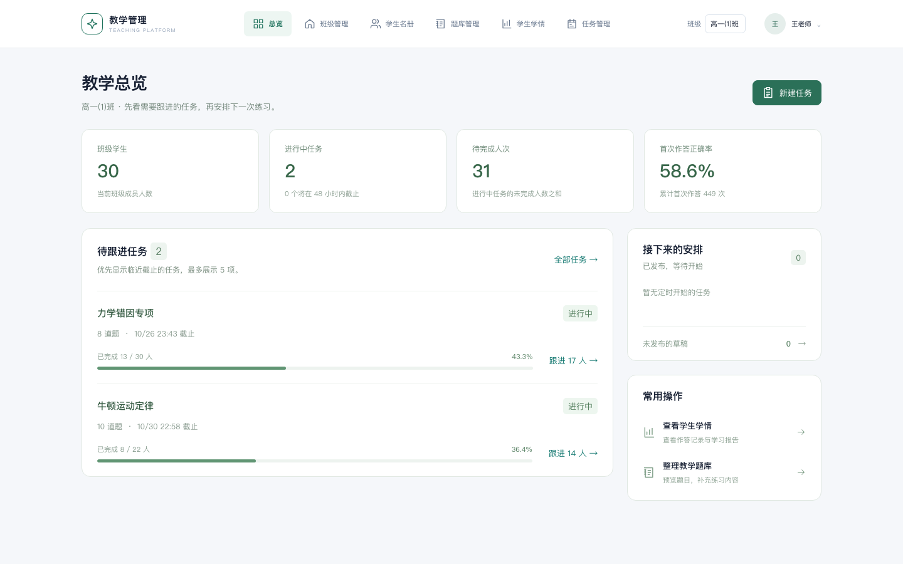
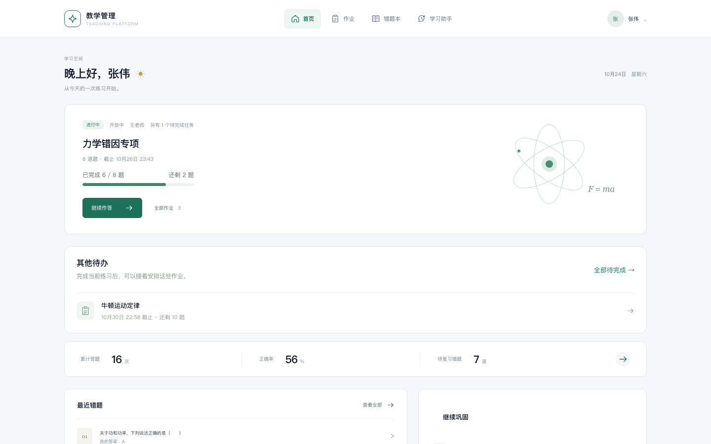
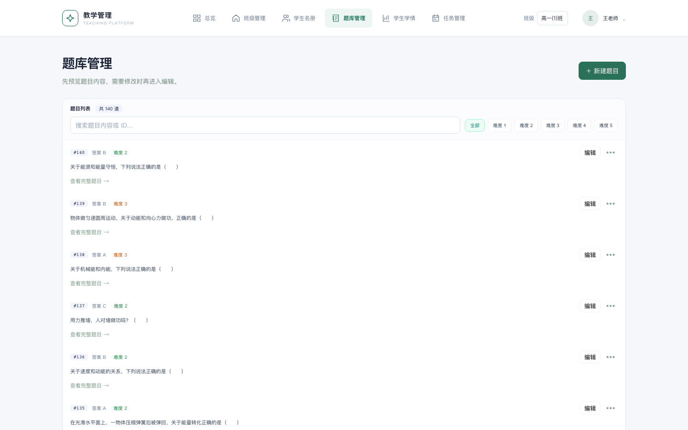
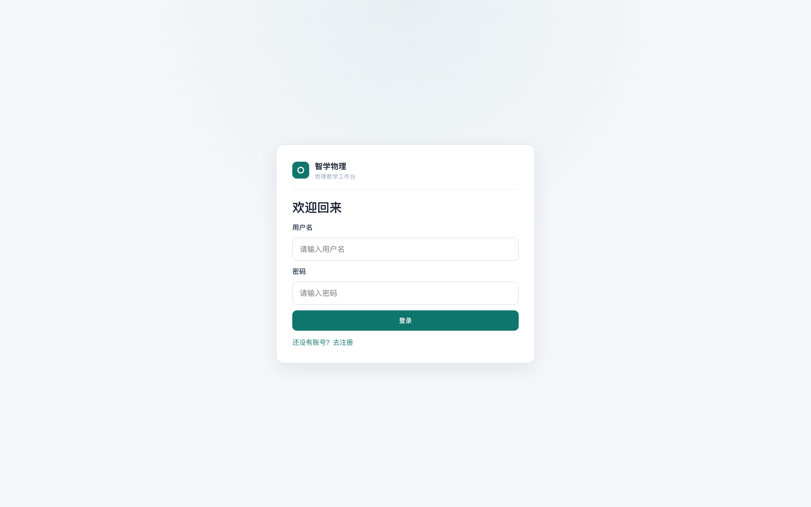
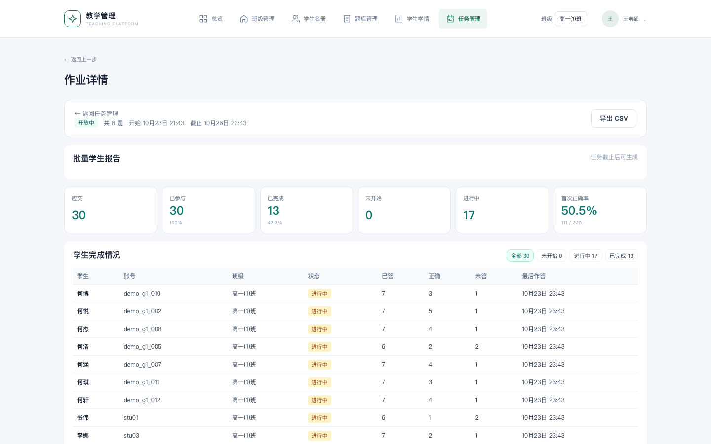
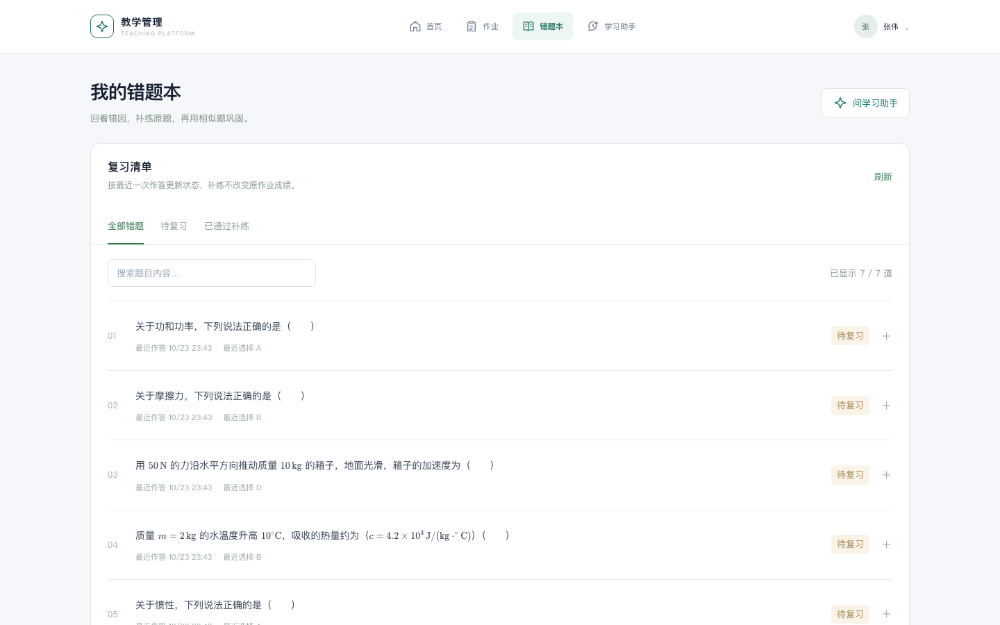
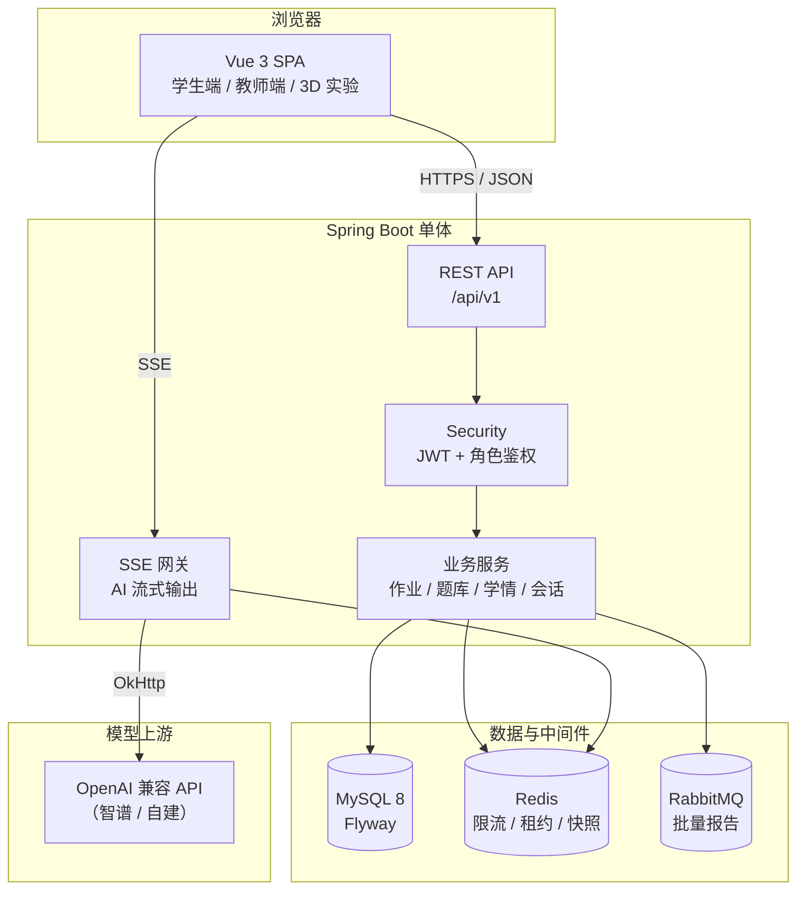

<div align="center">

# 教学管理平台 · Teaching Management Platform

**面向中学课堂的开源教学管理系统**

班级与账号 · 题库与作业 · 在线作答与错题 · 学情分析 · AI 辅导 · 批量报告

[](https://github.com/luoshuang148/physics-learning-platform/actions/workflows/ci.yml)
[](https://openjdk.org/)
[](https://spring.io/projects/spring-boot)
[](https://vuejs.org/)
[](https://www.mysql.com/)
[](LICENSE)

面向中学物理教师、学生与二次开发者，串起建班、作业、在线作答、错题与学情。<br>
Java 21 · Spring Boot 3 · Vue 3 · MySQL / Redis / RabbitMQ。<br>
[在线体验](http://47.110.38.57)：教师 `teacher / Teacher@2026`，学生 `stu01 / Student@2026`。<br>
演示数据可重置，请勿输入真实个人信息；本地部署见下方快速开始。

| 教师掌握作业进度 | 学生查看任务与学习进度 | 教师维护题库 |
|:---:|:---:|:---:|
|  |  |  |

本地体验（Docker Compose 2.24.4+）：`./scripts/demo-up.sh`

[快速开始](#-快速开始) · [功能](#-功能特性) · [架构](#-架构) · [文档](#-文档) · [贡献](#-贡献) · [English](#english)

</div>

---

## 界面预览

| 登录 | 教师总览 |
|:----:|:--------:|
|  |  |

| 题库管理 | 作业详情 |
|:--------:|:--------:|
|  |  |

| 学生首页 | 错题本 |
|:--------:|:------:|
|  |  |

## 项目简介

教学管理平台（Teaching Management Platform）是一套可本地部署的中学课堂教学管理系统，覆盖「建班建号 → 题库与组卷 → 发布作业 → 在线作答 → 错题与学情 → AI 辅导」完整闭环，面向日常课堂管理、课后巩固以及后端/全栈学习与二次开发。内置学科示例以物理为主，业务能力可扩展到其他学科的作业与学情场景。

| 角色 | 能做什么 |
|------|----------|
| **学生** | 在线作答、作业进度、错题本与掌握状态、AI 实时问答、作业复盘报告、3D 物理实验 |
| **教师** | 题库管理、按班级发布任务、完成率/正确率统计、学生学情分析、批量报告、账号与班级管理 |
| **运维/开发者** | Flyway 迁移、Docker Compose、CI 全链路验证、可插拔 AI 模型接入 |

> 设计重点在**权限边界、会话隔离、流式资源管理、数据生命周期**，而不是堆砌业务功能。当前为单体教学项目，已在 CI 中覆盖测试，但**没有生产流量与分布式性能证明**。

## 功能特性

### 学生端
- 注册登录（JWT + BCrypt），登录限流，退出/改密即时吊销令牌
- 作业列表与进度、首次作答与补练分离、幂等提交（`requestId` 重试不重复记分）
- 错题本按最后一次尝试展示掌握状态（复习清单支持全部/待复习/已通过补练筛选）；历史快照与题库解耦，改题不影响已做记录
- AI 实时问答与错题分析（SSE 流式，可取消）
- 可选班级讲义 RAG 错题辅导：来源卡片可展开，历史引用读取时重新鉴权（默认关闭）
- 学习助手：共享只读学情/错题/知识检索/练习推荐工具，固定工作流默认启用；Agent Function Calling 可配置但默认关闭
- 复习计划先预览再保存/激活，绑定作业作答版本，支持失效检测、本人运行耗时/用量详情和补练进度
- 作业复盘报告（按作答版本失效重算）
- 独立 3D 实验入口（原子物理 / 宇宙航天）

### 教师端
- 题库 CRUD、服务端分页与搜索、任务选题与有序快照
- 班级讲义上传、索引状态查看与撤回
- 多班级：学生归属主班，教师可协作多班；任务只发放到指定班级
- 任务生命周期：草稿 / 已发布 / 已截止 / 已归档，支持开始与截止时间
- 任务总览与作业详情：参与率、完成率、每题正确率、未交名单
- 学生学情分析、批量 AI 报告（RabbitMQ 异步 + 发件箱 + 租约 + 死信重试）
- 学生账号管理（启用/停用/角色/班级）

### 平台能力
- Spring Security + JWT；教师接口 `@TeacherOnly`；Redis 认证快照与登录限流
- SSE 全局/用户连接配额与租约回收；请求断开即取消上游模型调用
- AI 输出 HTML 净化并保留数学公式；对话按用户/任务/类型隔离
- Flyway 管理 schema；MySQL 8 空库迁移与 V7 升级路径均纳入 CI
- 一键种子数据：题库、班级、学生、任务、作答记录

## 技术栈

| 层次 | 选型 |
|------|------|
| 后端 | Java 21 · Spring Boot 3.3 · Spring Security · Spring Data JPA · Flyway |
| 前端 | Vue 3 · TypeScript · Vite · Pinia · Vue Router |
| 数据 | MySQL 8 · Redis（限流 / SSE 租约 / 认证缓存） |
| 消息 | RabbitMQ（批量报告异步生成） |
| AI | 兼容 OpenAI 协议的模型接口（默认可对接智谱，可替换） |
| 测试 | JUnit 5 · Testcontainers · Playwright · GitHub Actions |
| 3D 实验 | Three.js（`frontend/public/three-physical-project`） |

## 架构



更细的模块边界见 [docs/项目启动指南.md](docs/项目启动指南.md) 与源码 `src/main/java/com/zhixuewuli/`。

## 本地体验（Docker）

需要运行中的本机 Docker、Compose **2.24.4+**、OpenSSL、curl；安装 Python 3 才会自动准备学生和作业数据。首次构建耗时取决于网络与机器，不保证 5 分钟。

```sh
./scripts/demo-up.sh
```

访问 [localhost:8080](http://localhost:8080)。教师 `teacher / Teacher@2026`；只有脚本完成种子验证后，学生 `stu01 / Student@2026` 才可用于完整演示。没有 Python 时仅启动服务，不宣称已有学生数据。

仅用于本地演示，不要暴露公网；AI 默认关闭，AI 问答和批量 AI 报告不代表可用。使用独立 Compose 项目 `zhixuewuli-demo` 与具名卷，不修改生产 compose 的默认行为。脚本拒绝远程 Docker，且不会更改当前 context。密钥自动存入忽略的 `.env.demo`，不提交、不分享。

停止并保留数据：

```sh
docker compose -p zhixuewuli-demo --env-file .env.demo -f docker-compose.yml -f docker-compose.demo.yml down
```

成功初始化记录保存在专用 app 数据卷；仅在上次完整成功且四份任务题数/状态校验通过时，重复运行才会保留已有任务而不重新灌数。没有成功记录的残留数据会报错并保留；半途失败或手动删除数据后，先查看日志，备份需要保留的数据，再决定是否重建专用演示卷。不要对其他部署执行清卷命令。

## 快速开始

### 环境要求

- **JDK 21** · **Node.js 22** · **MySQL 8.0+** · **Redis** ·（可选）**RabbitMQ** ·（可选）**Docker**

### 1. 配置

```bash
git clone https://github.com/luoshuang148/physics-learning-platform.git
cd physics-learning-platform

cp .env.dev.example .env
# 编辑 .env：至少修改 DB_PASSWORD 与 APP_JWT_SECRET（≥32 位随机串）
```

### 2. 数据库

```bash
mysql -u root -p -e "CREATE DATABASE IF NOT EXISTS zhixuewuli \
  CHARACTER SET utf8mb4 COLLATE utf8mb4_unicode_ci"
```

应用启动时由 **Flyway** 自动建表/升级，无需手动执行 SQL。

### 3. 启动后端

```bash
# 首次创建教师账号（至少 12 位密码）
# 在 .env 中设置：
#   BOOTSTRAP_TEACHER_ENABLED=true
#   BOOTSTRAP_TEACHER_USERNAME=teacher
#   BOOTSTRAP_TEACHER_PASSWORD=your_password_at_least_12_chars

./mvnw spring-boot:run
```

启动后请将 `BOOTSTRAP_TEACHER_ENABLED` 改回 `false` 并删除明文密码。

### 4. 启动前端

```bash
cd frontend
npm ci
npm run dev
```

打开 <http://localhost:5173>。API 前缀为 `/api/v1`，开发环境默认关闭 AI，无需模型密钥即可体验核心功能。

### 5.（可选）消息队列与演示数据

```bash
# 批量报告依赖 RabbitMQ
docker compose up -d rabbitmq

# 灌入题库 / 班级 / 学生 / 任务 / 作答演示数据
python3 scripts/seed_test_data.py
```

种子数据包含 26 道物理题、2 个班级、13 名学生、4 个不同状态的作业与约 165 条作答记录，可直接用于界面演示。

更多细节（Docker、生产部署、AI 接入、升级旧库）见 [docs/项目启动指南.md](docs/项目启动指南.md) 与 [docs/生产部署指南.md](docs/生产部署指南.md)。AI 演示与评测状态见 [M2 演示脚本](docs/demo/ai-demo.md)、[评测结果状态](docs/ai-evaluation/m2-results.md)。

## 测试与 CI

```bash
# 后端（含 Testcontainers：Redis / RabbitMQ）
./mvnw -B test

# 前端
cd frontend && npm ci && npm test && npm run build
```

CI 覆盖：后端单测与集成、前端单测与构建、MySQL 8.4 空库迁移与 V7 升级、批量报告消息链路、Docker 启动与备份恢复。

## 文档

| 文档 | 内容 |
|------|------|
| [AI 应用升级计划](docs/superpowers/plans/2026-10-23-ai-application-upgrade.md) | RAG、工具工作流、评测和交付分阶段计划 |
| [M1 评测状态](docs/ai-evaluation/m1-results.md) | 隔离评测步骤、语料说明与尚未完成的人工/模型评测 |
| [三分钟演示脚本](docs/demo/m1-demo.md) | 面向隔离演示环境的流程与当前准备状态 |
| [AI 学习助手演示](docs/demo/ai-demo.md) | RAG 辅导、工作流/Agent 计划与补练流程 |
| [面试技术说明](docs/demo/interview-notes.md) | 架构、权限、评测与技术取舍 |
| [简历项目描述](docs/demo/resume-project.md) | 可核验的项目表述与指标边界 |
| [M2 评测状态](docs/ai-evaluation/m2-results.md) | 自动验证证据和待外部验证项 |
| [项目启动指南](docs/项目启动指南.md) | 本地开发环境完整步骤 |
| [生产部署指南](docs/生产部署指南.md) | 镜像、备份、HTTPS、监控 |
| [学生使用指南](docs/学生使用指南.md) | 学生端操作说明 |
| [教师使用指南](docs/教师使用指南.md) | 教师端操作说明 |
| [开源组件清单](docs/开源组件清单.txt) | 第三方组件与许可证 |

## 现状与边界

为了不误导使用者，这里明确说明**当前没有做到**的事：

- 单体架构，无生产流量与分布式性能数据；跨实例会话互斥与取消路由尚未实现
- AI 上游为阻塞 I/O，未做全链路非阻式与自动续传；题目缓存仍在本地
- 固定 AI 评测样例仍需人工评分；本地合成数据不代表生产容量
- 学习助手完整用量表已实现；目标模型费用、人工物理复核和真实工作流/Agent 对比尚未完成
- 仓库含既有实验/视频资源，再分发前请阅读 [LICENSE](LICENSE) 与[开源组件清单](docs/开源组件清单.txt)

## 贡献

欢迎 Issue 与 Pull Request。

1. Fork 本仓库并创建分支：`git checkout -b feature/amazing`
2. 提交前请保证测试通过：`./mvnw -B test` 与 `cd frontend && npm test`
3. 遵循既有代码风格，PR 中说明动机与验证方式

详见 [CONTRIBUTING.md](CONTRIBUTING.md) 与 [CODE_OF_CONDUCT.md](CODE_OF_CONDUCT.md)。安全相关问题请见 [SECURITY.md](SECURITY.md)。

## 许可证

[MIT License](LICENSE) © Teaching Management Platform

---

## English

**Teaching Management Platform** is an open-source classroom operations system: classes & accounts, question bank, assignments, answer records & wrong-question book, streaming AI tutoring, and teacher analytics.

**Highlights**

- Java 21 + Spring Boot 3 + Vue 3 + MySQL/Redis/RabbitMQ
- JWT auth, per-class task delivery, idempotent submissions, snapshot isolation
- SSE streaming AI with cancellation and connection quotas
- Flyway migrations, Testcontainers, Playwright and GitHub Actions CI
- One-command demo data seed (`scripts/seed_test_data.py`)

**Quick start**: see [Quick Start](#-快速开始) above. Docs are primarily in Chinese; API and code comments follow standard English conventions. Licensed under [MIT](LICENSE).
