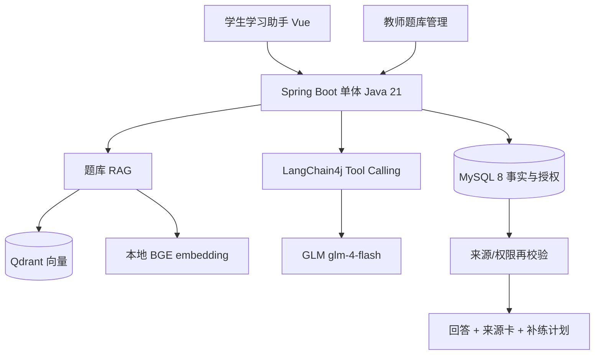

# 物理学习平台 AI 学习助手 — 架构说明（v2）

版本：2026-10-24。配合 `2026-10-24-ai-study-assistant-design.md` 使用。
本文只描述**已实现并实测过**的结构；未验收能力不写入。

## 1. 总览



- **MySQL 是当前有效版本的依据**；Qdrant 只做异步镜像，可重建。
- **SQL 管事实**（作答、权限、计划），**RAG 管找题**（自然语言 → 平台题）。
- **模型只产生建议**；保存/激活计划由用户确认后的确定性接口完成。

## 2. 题库检索链路

| 组件 | 职责 |
|---|---|
| `QuestionSourceBuilder` | 题干/选项 → QUESTION 单元，解析按段 → EXPLANATION 单元；2/3 字 n-gram 关键词；禁止静默截断 |
| `QuestionSourceIndexService` | 业务修改同事务入队 `question_index_jobs` |
| `QuestionIndexWorker` | 双 worker、租约 120s/续租 30s、最多 3 次尝试（退避 5s/30s）；写 MySQL 单元 + Qdrant 点后才发布 READY |
| `QdrantQuestionVectorIndex` | 独立题库 collection（含模型/维度版本）；pointId 为确定性 UUID |
| `QuestionRetrievalAccessPolicy` | `ai_practice_enabled=true` + 待考题保护 + excludeAttempted；不接受模型指定 userId |
| `PlatformQuestionRetriever` | 关键词 + 向量双路，RRF(k=60)，最多 5 题 5 来源；关键词无命中时提高向量分门槛（0.62） |

来源 ID 形如 `Q:{questionId}:{revision}:{part}:{ordinal}`，查看时**重新鉴权**。

## 3. 一致性

```
教师改题 → revision+1 → 同事务 enqueue job
              ↓
     worker 认领租约 → 分块 → embedding → upsert Qdrant
              ↓
     源题 revision 仍匹配？ → 是 → 写 search_units + 发布 READY
                              → 否 → OBSOLETE（旧任务晚完成不覆盖）
```

- 删除/禁用：入队 DELETE 墓碑，向量异步清理。
- 重试幂等：同 (questionId, revision, type) 单行；pointId 确定性。

## 4. Agent 与工具

单 Agent + 确定性工作流对照（`AGENT` / `WORKFLOW`）。

| 工具 | 作用 |
|---|---|
| `get_learning_summary` | 本人作业统计（服务端算） |
| `get_wrong_questions` | 本人错题与历史快照 |
| `search_platform_questions` | 自然语言找平台题 → 写入 `PlanCandidateRegistry` |
| `get_question_evidence` | 读取已授权来源原文 |

约束：最多 6 轮 / 8 次工具 / 总 60s / 单模型 25s / 单工具 5s。
计划只允许引用**本次运行 registry 中的 candidate/source**（`validateFromRegistry`）。

实测（2026-10-24，GLM `glm-4-flash`）：
```
tool-step get_learning_summary SUCCEEDED
tool-step search_platform_questions SUCCEEDED
plan   {items:[{questionId..., reasonSourceIds:["Q:31:1:EXPLANATION:0",...]}]}
complete status=success executionMode=AGENT
```

## 5. 权限与历史事实

- 待考题保护：未首次作答的进行中/未开始作业关联题，整题不进新检索与补练候选。
- 错题讲解以本人作答快照为事实；题库最新解析单独标明版本。
- 提示词注入文本只作数据，不取得工具权限。
- 重复 `requestId` 返回原 runId，不再调用模型。

## 6. 数据表（v2 新增）

| 表 | 用途 |
|---|---|
| `questions.ai_practice_enabled` / `ai_content_revision` | 发布开关与修订号 |
| `question_search_units` | 可检索单元（有效版本依据） |
| `question_index_jobs` | 持久任务、租约、墓碑 |
| `question_index_publications` | 发布记录 |
| `assistant_conversations/messages/runs` | 助手会话、公开消息、运行遥测 |
| `learning_plan_items.question_revision/snapshot` | 激活时题目快照 |
| `learning_plan_attempt_links` | 补练记录按 planItemId 归属 |

## 7. 边界（首版不做）

多智能体、GraphRAG、模型微调、网页搜索、图片 OCR、Python 在线微服务。
