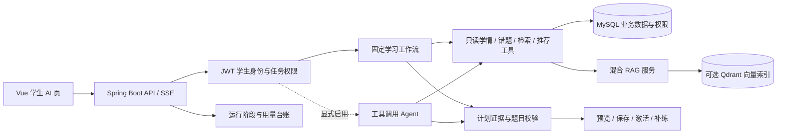

# 面试技术说明

## 项目问题与实现

项目原本已有作业、作答、错题和学生身份数据。增强版本复用现有业务权限，增加班级讲义 RAG、按题目知识点映射的只读学习工具、复习计划工作流/可选动态 Agent，以及计划生命周期和补练反馈。

## 可以展示的取舍

- **直接 API 调用**：保留模型供应商适配层，不引入通用 Agent 框架。当前工具集合小且权限依赖已有教学域，直接适配更容易执行服务端授权、时间预算和响应校验。
- **工作流与 Agent 分开**：工作流默认，步骤确定；Agent 只在模型明确发出工具调用时执行，受 6 轮/8 次工具/总时限约束，使用同一权限化工具与计划验证器。Agent 默认关闭，待目标模型协议验证。
- **模式对照（实现状态）**：

  | 项目 | 固定工作流 | 动态 Agent |
  |---|---|---|
  | 下一步由谁决定 | 服务端按业务规则 | 模型通过 Function Calling 选择工具 |
  | 可访问的工具 | 共享四个只读工具 | 同一组只读工具 |
  | 约束 | 请求总时限/参数校验 | 6 轮、8 次工具、单工具时限、总时限、循环检测 |
  | 当前默认 | 是 | 否，需显式配置 |
  | 效果对比 | 未测 | 未测；不可声称优于工作流 |
- **RAG**：MySQL 保存资料/班级权限和版本，Qdrant 做向量候选，混合检索结果回查当前活动版本；历史来源再次授权。索引能重建，权限事实在关系库。
- **安全输出**：工具不接受模型或客户端指定的用户身份；推荐题必须来自当前任务候选；计划激活重验作答版本，原作业成绩不因补练改写。
- **运行观测**：运行详情只保存身份关联、状态、阶段和计量字段，不存 prompt 或工具参数。低基数指标不带用户/run 标签，价格未知不写 0。

## 已验证证据与边界

本分支后端 unit suite 共 628 项通过，Python 评测合同 16 项通过；已有 MySQL V15 计划并发验证记录在计划文档中。V16 fresh-schema 验证因本次容器连接中断待重跑。未完成教师物理复核、目标 provider 付费 tool-call smoke、真实 A/B 质量对照和部署备份恢复演练。不要声称准确率提升、Agent 优于工作流、生产级成本或生产容量。

## 建议现场讲解顺序

从一条学生错题开始，展示证据来源，再展示工具步骤、服务端权限边界、计划版本校验与补练反馈。最后展示一个不足/失败案例和上述待测项，说明哪些是测试结论、哪些尚无实证。
