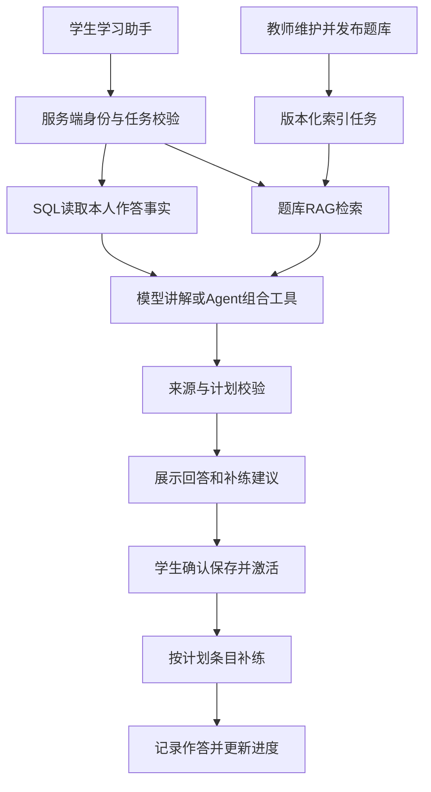

# 物理学习平台 AI 学习助手方案

日期：2026-10-24  
状态：方案交付；尚未执行本轮实现。用户已认可“题库 RAG → 学习记录与工具调用 → 评测 → 面试演示”的方向。下文技术数值和接口是本次建议，属于待实现设计，不代表现有能力或实测结果。

本方案是后续 AI 升级的主线，替代旧方案中以“班级上传讲义”为核心的产品定位；旧方案和历史评测文件保留作为参考，不把其中未验收的功能自动计为完成。

## 1. 定位和成果

目标岗位：AI 应用开发 / 大模型应用开发实习。保留现有物理教学业务，建设一个能够检索平台题库、引用原题解析、结合本人作答安排补练的 AI 学习助手。目标成果是可运行的产品、可复现的评测和能够解释的工程设计。

唯一主线：学生提问 → 查找平台内相关题目和方法 → 引用依据解释 → 结合本人错题推荐补练 → 用户确认 → 作答 → 查看补练记录。

核心演示请求：“我总分不清作用力与反作用力。结合本次作业，找三道我没做过的相关题，并解释推荐原因。”

验收的三条学生流程：
- A：自然语言搜题与方法查询，回答显示平台来源卡片，点击可以查看有权访问的原题和解析。
- B：从错题本进入辅导，自动携带作答记录，使用当时题目快照解释，并明确区分事实与可能的错因。
- C：选作业生成 1～7 天、最多 6 题的补练建议，保存草稿、激活、完成练习、刷新本人计划进度。

## 2. 当前基线与待补缺口

| 模块 | 已核对的基础 | 本轮工作 |
|---|---|---|
| 业务平台 | Java 21、Spring Boot、Vue；账号、角色、班级、题库、任务、作答、错题本 | 复用 |
| 通用问答 | 学生入口、多轮会话机制、SSE、停止生成；页面刷新后未接入完整历史恢复 | 整理为统一助手，补历史与异常恢复 |
| RAG | 本地 BGE、Qdrant、关键词检索、RRF、来源与索引相关代码 | 增加题库来源；普通问答尚未接入题库 RAG |
| 文档知识库 | 两个班共 7 份模拟文档已在前一轮验证 READY | 保留为辅助资料，不继续把“上传讲义”作为主线 |
| Agent | LangChain4j 工具调用、工具白名单、调用上限和计划校验代码 | 接入新检索工具，配置并实测真实 Tool Calling；最近运行检查 agentReady=false |
| 计划闭环 | 草稿、激活、取消、进度代码已存在 | 验证并修复跨原作业题目的练习入口和进度归属 |
| 评测 | Python 脚本，已有 60 开发/40 留出问答样例和 20 Agent 任务 | 重新适配题库场景；原结果文档明确尚未完成真实模型效果评测 |

特别注意：现有 KnowledgeVectorStore 的签名绑定 classId/revisionId，不能直接把全局题目伪装成某个班级文档；LearningPlanService 目前按原作业 eventId 汇总补练，必须新增准确的计划条目归属。

## 3. 架构选择与边界

采用当前 Java 单体内增加题库检索与助手编排模块，继续复用 Vue、MySQL、Qdrant、LangChain4j 和本地 BGE。Python 用于模拟数据、评测和结果分析。

考虑过另建 Python AI 服务：有利于练习 Python 后端，但当前会新增鉴权、跨服务状态、部署和接口维护成本，首版不采用。模型训练/微调、多智能体协作、GraphRAG、网页搜索、图片 OCR 不纳入首版。后续有岗位或效果证据再决定。

明确分工：
- 已知题目 ID、分数、作答记录、是否做过：由数据库和业务规则查询。
- 自然语言找平台题目、相似题、跨题查方法：由 RAG 语义检索。
- 概念讲解、组织检索依据、解释推荐理由：由模型生成。
- 根据任务选择工具、组合信息并生成计划建议：由单 Agent 完成。
- 保存、激活计划：由用户操作触发确定性接口，模型没有直接写库工具。

保留现有教师资料页面和旧接口，不删除已有资料；学生默认主入口统一为“学习助手”。教师题库增加“允许用于 AI 补练”和索引状态。旧文档检索仍可独立使用，但首版 Agent 主工具检索题库，不自动把班级资料混入结果。

## 4. 用户界面

学习助手只保留两个主要页签：
1. “问答与找题”：选择“通用讲解”或“平台题库”；来源卡显示题目标题/摘要、知识点、引用段落、查看原题。普通用户不看到向量分数和工具参数。
2. “补练计划”：选择本人作业、输入目标、选择天数；显示可读执行步骤、建议题目、推荐依据、草稿与激活按钮。

错题本增加“问学习助手”，传 recordId，不让学生手填题目 ID。默认问题为“请结合我的作答解释这道题，并给我相关练习建议”，用户可修改后再发送。

教师在题库维护题目与解析后决定是否启用 AI 补练；索引状态采用“待处理 / 建立中 / 可检索 / 失败”。只有可用文字内容且解析完整的题才能启用。纯图片或解析缺失的题明确提示需要补录文字。

通用讲解不会显示虚构来源；平台题库无匹配时显示“平台暂无足够相关内容”，可由学生主动切换通用讲解。检索服务故障显示“检索暂不可用”，不能假装无资料。

## 5. RAG 数据与索引

### 5.1 题库来源

首版核心语料是平台自行维护的题干、选项、核对后的答案解析及知识点标签。来源稳定关联 questionId，不把学生私密作答写入向量库。

questions 新增 ai_practice_enabled（默认 false）、ai_content_revision（默认 1）。修订号在题干、选项、正确答案、解析、难度、标签、AI 启用状态或图片变化时递增；纯时间戳变化不递增。教师手动审核后开启；模拟导入脚本只显式开启已校验的演示题。

每道题分成 QUESTION（题干与选项）和 EXPLANATION（解析）两类检索单元；短题整体保留，长解析按段落拆分，目标每段不超过 400 汉字且不得超过当前 embedding 模型的有效 token 上限，禁止静默截断。公式、选项和推导段落尽量保持完整；超过上限则继续分段。token 上限由依赖模型元数据/实测边界确认后写入配置与测试。

索引元数据包含 questionId、revision、part、ordinal、knowledgePointCodes、difficulty、contentHash、embeddingModel、embeddingDimensions、indexVersion。来源 ID 为 Q:{questionId}:{revision}:{part}:{ordinal}。

### 5.2 一致性

新增 question_search_units 保存可检索文本/版本；question_index_jobs 保存持久任务、尝试次数与租约。题目业务修改和索引任务同事务提交。两个 worker，单任务最多 3 次尝试，失败后分别等待 5 秒、30 秒；第三次失败进入 FAILED，可由教师重试。租约 120 秒，每 30 秒续租。

MySQL 是当前有效版本的依据。任务写入 Qdrant 后，只有源题修订仍匹配才发布 READY；旧任务晚完成不能覆盖新版本。Qdrant 点 ID 幂等生成，失败重试不增加重复点。禁用/删除题目后立即从 MySQL 有效候选中排除，向量异步清理；读取时再次校验题目状态与版本。

### 5.3 检索与生成

1. 根据当前学生权限、AI 发布状态、待考题保护、是否做过、难度/知识点条件生成候选题 ID 集合。
2. 同一候选集合同时约束关键词和向量检索。首版沿用 MySQL 文本检索，确认中文分词配置；不能将其标记为尚未实现的 BM25。
3. 两路各取 10 个单元，按 RRF(k=60) 融合，去重并限制最多 5 个来源单元；题目搜索返回最多 5 道题，同题多个段落不得占满题目列表。
4. 从 MySQL 回源获取有效文本并再次鉴权，随后才进入模型上下文；结果不足时返回真实数量。
5. 输出带来源 ID 的解释与引用卡片。引用校验只能证明 ID 来自返回集合，回答是否被来源支持仍需效果评测。

关键词、向量、混合三种模式均可在评测中独立运行。相关性阈值在开发集调整并冻结，禁止直接把相似度当成正确概率；reranker 仅在误召回分析证明有收益时引入。

## 6. 权限与历史事实

- 平台题库沿用现有全局题库管理权限，AI 启用项继承既有教师编辑权限；班级文档仍受原班级权限控制。
- 新检索入口、来源查看、模型上下文、计划保存/激活、每次练习均调用统一 QuestionRetrievalAccessPolicy；它复用现有 AnswerAccessPolicy 与任务可见性校验，首版沿用当前较保守的待作答题保护范围，不顺便放宽权限。
- 对尚未首次作答的进行中/未开始作业关联题，整个题目不进入新 AI 题库检索与补练候选。此限制约束解释内容和题干，不能从检索摘要或向量结果绕过。
- 学生个人记录只来自服务端认证用户；工具不接受模型传入的 userId/classId。来源 ID 即使猜中也要重新鉴权。
- 错题讲解以本人原作答快照为事实，题库最新解析作为补充来源单独标明版本。题库被修改不能重写过去的作答事实。
- 提示词注入、包含“忽略规则”的题目文本都作为数据，不取得工具权限；上下文进入前先通过权限筛选。

## 7. Agent 与计划

复用一个 Agent 和一个确定性工作流，分别标记 AGENT / WORKFLOW，失败时明确提示，不静默冒充成功 Agent。

工具限定为：
- get_learning_summary：本人选定作业统计，计算结果由后端产生。
- get_wrong_questions：本人错题与历史快照。
- search_platform_questions：依据自然语言、知识点、难度和 excludeAttempted 检索平台候选题及来源。
- get_question_evidence：读取已授权候选的原题与解析，重新检查版本和权限。

模型最多交互 6 轮、调用 8 次工具，总时限 60 秒，单模型请求最多 25 秒、单工具最多 5 秒。参数范围校验、重复调用识别、取消传播沿用并补测。最终计划仅允许引用本次运行实际返回的 candidate/source；跨多次检索取并集并按 questionId+revision 去重，不仅保留最后一次工具结果。

输出 1～7 天、最多 6 道不重复题；用户要求“没做过”时按其全部首次作答与补练记录排除。若只找到 2 道则说明部分建议，不编造第 3 道。把“可能的知识点问题”作为建议，不将错误选项当作心理诊断事实。

保存计划前再次校验权限、源作业作答版本、题目修订；激活时再校验。计划条目记录完整题目快照和来源。现有计划最多 6 题约束保留。

跨题补练使用 planItemId：原 eventId 仅表示诊断来源。新增计划练习接口按条目授权并计分，生成 practice=true、eventId=null 的作答，并在同一事务中关联条目。此记录不得混入原作业首次成绩，原计划进度按 planItemId 汇总；同题属于多个计划时一次作答仅计入对应条目。题目在激活后被禁用、修改或重新受任务保护时拒绝新练习并提示重新生成，历史记录仍保留。

## 8. 对话、接口和可观测性

保留原 API 前缀 /api/v1，新增统一助手端点，不在首版替换全部旧 AI 接口：
- POST /ai/student/assistant/messages：SSE，question(1～800字)、mode(GENERAL/PLATFORM)、conversationId?、eventId?、recordId?、requestId(UUID)。错题模式通过 recordId 自动解析上下文；显式 eventId 与记录冲突则拒绝。
- GET /ai/student/assistant/conversations：本人最近 30 个会话。
- GET /ai/student/assistant/conversations/{id}/messages：本人会话分页，每页最多 50 条。
- POST /ai/student/platform-search：无需调用生成模型的检索接口；query(1～500字)、eventId?、knowledgePointCodes?(最多15)、difficulty?(1～5)、excludeAttempted、limit(1～5)。
- GET /ai/student/platform-sources/{sourceId}：重新鉴权后查看来源。
- 保留 /ai/student/learning-plan/preview 与 /learning-plans 草稿、激活、取消接口。
- GET /learning-plans/{id}/items/{itemId}/question：获取本人有效计划条目的题干与选项。
- POST /learning-plans/{id}/items/{itemId}/answers：userAnswer、requestId；服务端确定题目与归属，返回计分与最新进度。

会话按 userId+mode+eventId+recordId 绑定；上下文变化新建会话，旧历史不能混入另一个任务。新增 assistant_conversations/messages/runs，保存用户问题、公开回答、来源快照、模式和完成/失败/取消状态，不把模型内部推理作为产品必需数据。每轮重新校验历史来源，已失去权限的内容不得送入新模型请求，历史读取同时做来源可见性处理。旧知识辅导 ai_runs 等历史继续可读，不整体重建。

SSE 使用 progress / sources / content / complete / error；Agent 保留 tool_step / plan。事件携带 runId、递增 seq。用户手动取消保留已显示的公开文本并标记 CANCELLED；迟到事件不能覆盖新运行。重复 requestId 返回 409 和原 runId，客户端刷新记录，不再调用模型。

日志记录 query/embedding/index/prompt 版本、检索模式、候选 ID、所用来源、工具步骤、状态、检索耗时、模型首字耗时、总耗时、实际 token。密钥不入日志，用户问题和作答正文默认不写普通运行日志。价格配置缺失或模型未返回用量时保持费用未知；估算与实际值分开。

## 9. 数据与评测设计

初版聚焦力学 4 个主题：运动学、牛顿定律、摩擦力、功与能。计划准备 120 道经检查的文字题，每主题 30 道，覆盖难度 1～3、不同题型表述、常见错误和相近但无关题。每题有稳定 fixtureKey、来源标记、知识点与完整解析；不靠改数字制造大量近重复题。

复用现有 60 个模拟学生/两个班，建立可复现的全对、概念混淆、单位错误、改善中、新用户、数据稀少等画像；固定随机种子，按当前时间生成有效作业窗口。保留原数据，导入按 fixtureKey 幂等，仅管理自身模拟记录。

重新适配 100 个问答/检索任务（60 开发、40 留出），新增或修订 20 个计划任务。按题型模板/推理方法分组拆分，近重复题和问题改写不得跨开发/留出集；留出集只用于冻结后的最终评测，不参与调参。检索语料可以包含目标题，检索问题与标签不能泄露给模型提示词。

对比：关键词 / 向量 / 混合检索；相同模型和提示模板下的无检索 / RAG 回答；相同任务与数据下的 WORKFLOW / AGENT。通用物理回答质量与“必须找平台实际题目”的任务分开评分。

建议验收目标（不是现有成绩）：
| 指标 | 定义与初始目标 |
|---|---|
| 检索命中 | 对有相关题的任务，Hit@5≥85%；多相关题另报 Recall@5；题目级去重 |
| 无结果处理 | 无相关内容样例，不编造平台题号/来源，正确处理比例≥90% |
| 引用有效性 | 每个来源 ID 必须来自本次授权结果，结构校验通过率100%；不等同语义支持正确 |
| 回答质量 | 人工按物理正确、证据支持、回答问题三维评分；各维通过率及分母独立公布，初始目标≥85% |
| 计划质量 | 可解任务的约束满足成功率≥85%；假题号、越权、无确认写入为0；不可解任务另评如实说明 |
| 权限与版本 | 跨用户、待考题、已删除、失效版本等确定性用例全部通过 |
| 延迟与成本 | 报检索、首字、总耗时p50/p95及样本数；固定硬件/并发/模型；不预先宣传提升百分比 |

未达到目标时记录失败、修改开发集方案再冻结；留出失败如实报告，不能重复调优后当作首次成绩。少量样本不宣称显著提升，更不将正确率变化解释为真实教学提分。

## 10. 阶段、交付与资源

| 阶段 | 交付 | 预计有效开发日* |
|---|---|---|
| M0 基线 | 环境检查、现有功能清单、稳定演示账号与故障记录 | 1 |
| M1 题库 RAG | 题库发布/索引、可授权检索、来源卡、真实 RAG 问答 | 4～6 |
| M2 个性化闭环 | 自动关联错题、工具调用、计划、跨题补练与进度 | 4～6 |
| M3 效果验证 | 模拟数据、冻结语料、对比评测、故障与性能报告 | 3～5 |
| M4 面试交付 | 一键启动说明、演示流程、架构文档、可证实简历表述 | 1～2 |

*为单人开发工作量估算，共约13～20个有效开发日；不是自动执行承诺。模型服务可用性、中文检索配置、人工复核时间会影响排期。

真实模型调用采用明确上限。计划建议首次每模式5例做连通性与输出检查，再分批扩大；执行前从价格配置算出请求数和费用上限并记录，未配置上限则不运行批量付费评测。本机 BGE 不产生外部 embedding API 费用，但记录CPU/内存耗用。

完成标准：A/B/C 三条浏览器流程实际跑通；权限与版本测试通过；有真实 RAG 和真实 Tool Calling 的运行记录；有冻结数据的效果报告和失败样例；干净环境按文档能够复现；简历只写已实现且可展示的指标。

## 11. 面试展示与诚实表述

演示顺序：自然语言检索平台题 → 查看引用 → 从错题进入 → Agent 调用本人数据与检索工具 → 确认计划 → 补练计入进度 → 展示一次无匹配/权限拒绝 → 查看评测。

可以讲：为什么 SQL 和向量检索分工、为什么按题目/段落分块、中文公式处理、混合召回失败案例、题库更新一致性、工具边界、模型成本与超时、评测拆分与过拟合。

待完成后可使用的项目描述：“基于 Spring Boot 与 Vue 构建物理学习助手，将题库语义检索、来源引用和学生作答分析结合，并通过受约束工具调用生成可确认的补练计划。”性能、准确率和用户规模必须等实测再补。

## 12. 招聘方向依据

以下是上一轮已核对的岗位说明，仅用于对齐能力，不表示仍开放投递：
- DXC AI应用开发实习：模型应用、Prompt、知识库问答与后端开发；https://dxctechnology.wd1.myworkdayjobs.com/DXCJobs/job/CHN---SHANGHAI/AI_51589643
- 美图2026暑期 Agent 实习：RAG、Tool Calling、自动评测、可观测性，认可多种主流语言；https://hr.meitu.com/en/jobCampus/5996c55a-6237-4732-bee0-89b8ce53bbad

Python基础、数据结构、数据库与后端能力仍需准备。单个项目能提供实践证据，不能保证面试或替代这些基础。
